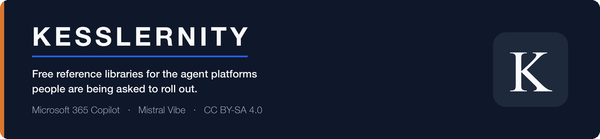

  

  <a href="#microsoft-365-copilot"><strong>Copilot libraries</strong></a>
  &nbsp;&bull;&nbsp;
  <a href="#mistral-vibe"><strong>Mistral Vibe libraries</strong></a>
  &nbsp;&bull;&nbsp;
  <a href="#both-runtimes"><strong>Both runtimes</strong></a>
  &nbsp;&bull;&nbsp;
  <a href="#the-rule-that-caps-all-of-it"><strong>The rule that caps all of it</strong></a>
  &nbsp;&bull;&nbsp;
  <a href="https://www.kesslernity.com/what-broke?utm_source=github&utm_medium=profile&utm_campaign=gh_profile&utm_content=nav"><strong>What broke</strong></a>

  
  
  
  

---

I publish free reference libraries for the agent platforms people are being asked to roll out, and I write down what breaks.

Two vendors are covered here, and the material is not a pitch for either. Where a claim comes from a vendor, the repository names the page and the date it was read.

## Microsoft 365 Copilot

| Repository | What it is | |
|---|---|---|
| [**awesome-microsoft-copilot-prompts**](https://github.com/kesslernity/awesome-microsoft-copilot-prompts) | 573 prompts across 18 categories |  |
| [**awesome-copilot-studio-agents**](https://github.com/kesslernity/awesome-copilot-studio-agents) | 103 declarative agents across 17 domains, for Copilot Studio |  |
| [**awesome-copilot-chat-agents**](https://github.com/kesslernity/awesome-copilot-chat-agents) | 82 agents for Copilot Chat, no premium licence required |  |
| [**awesome-copilot-agent-skills**](https://github.com/kesslernity/awesome-copilot-agent-skills) | 137 custom skills across 29 disciplines for Agent Builder, a Microsoft preview limited to Frontier tenants |  |
| [**awesome-copilot-cowork-skills**](https://github.com/kesslernity/awesome-copilot-cowork-skills) | 21 workflow skills and a 16-persona review suite for Cowork |  |

## Mistral Vibe

| Repository | What it is | |
|---|---|---|
| [**awesome-mistral-vibe-skills**](https://github.com/kesslernity/awesome-mistral-vibe-skills) | 137 Agent Skills in the format the Vibe CLI reads |  |
| [**awesome-mistral-vibe-agents**](https://github.com/kesslernity/awesome-mistral-vibe-agents) | 17 agent profiles, all passing a checker that ships in the repo and reproduces the two calls inside Vibe's loader |  |
| [**awesome-mistral-vibe-prompts**](https://github.com/kesslernity/awesome-mistral-vibe-prompts) | 49 prompts for Vibe Work, scheduled tasks and Chat |  |

Alongside them, [**excom-office-vibe**](https://github.com/kesslernity/excom-office-vibe) is one free skill rather than a library: it turns committee documents into a decision-ready executive brief, and it drafts for a human rather than approving anything. Free to use commercially, not open source, and you cannot sell it on.

## Both runtimes

| Repository | What it is | |
|---|---|---|
| [**agent-desks**](https://github.com/kesslernity/agent-desks) | Nine desks. Each one is a role, the skills it uses on either runtime, and a page naming what a person has to sign. The build fails on a pack that names a skill neither library has, or names nothing it refuses to decide |  |

## The rule that caps all of it

> **AI prepares, humans decide.**
>
> Nothing in these libraries authorises a permit to work or a lockout, closes an incident, or signs off an inspection. Where a skill touches a decision like that, it drafts the paperwork and stops.

## When it is wrong

Before I publish a listing I have three models from different labs attack it, and I make the call. They do not catch everything. What got through is written up rather than quietly edited, dated, with the fix: **[kesslernity.com/what-broke](https://www.kesslernity.com/what-broke?utm_source=github&utm_medium=profile&utm_campaign=gh_profile&utm_content=fail_line)**.

The nine libraries above are CC BY-SA 4.0. ExCom Office is free under a source-available licence that forbids resale. Not affiliated with, or endorsed by, Microsoft or Mistral AI.
